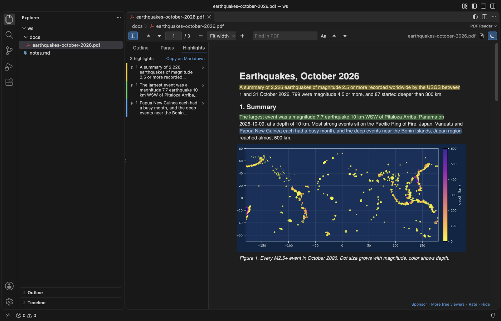
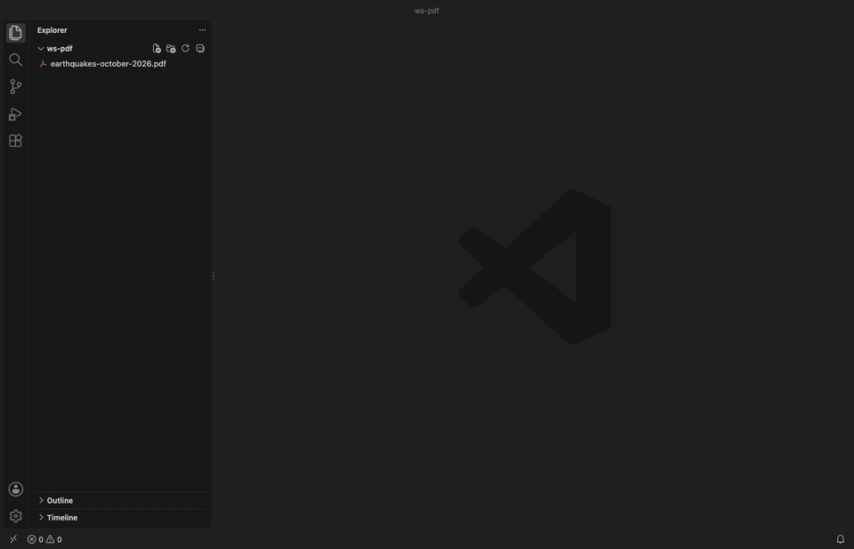
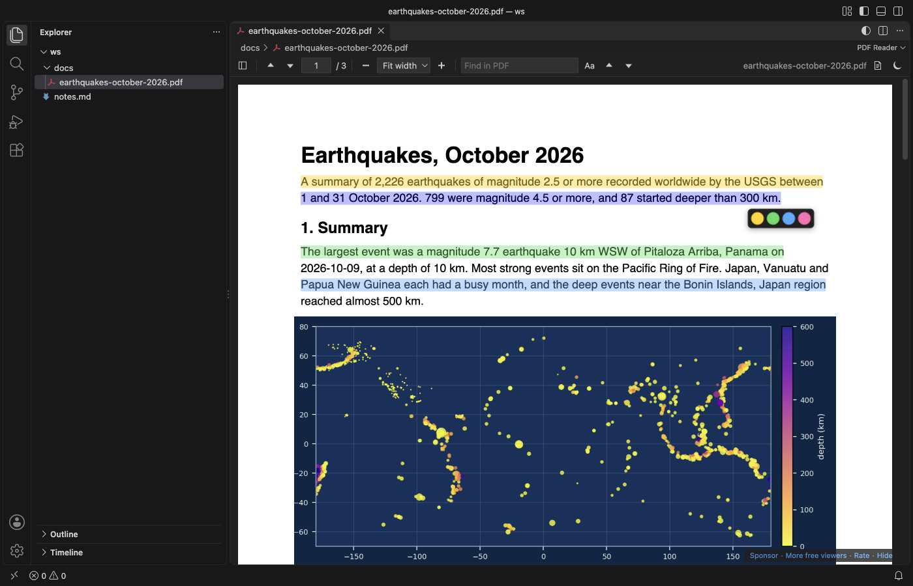
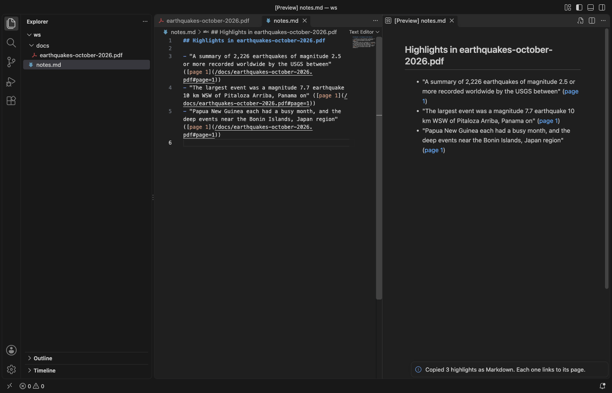
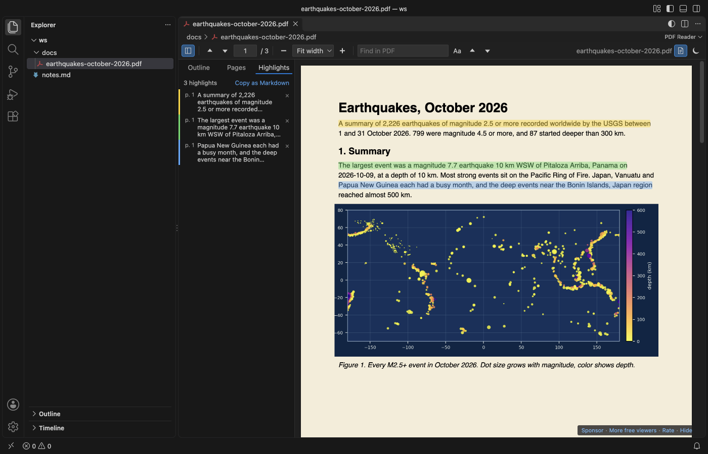
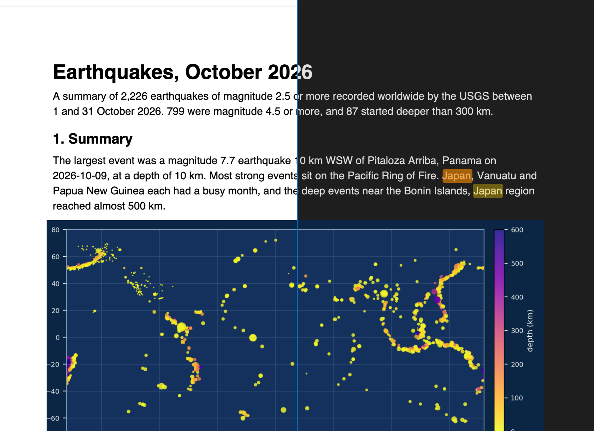
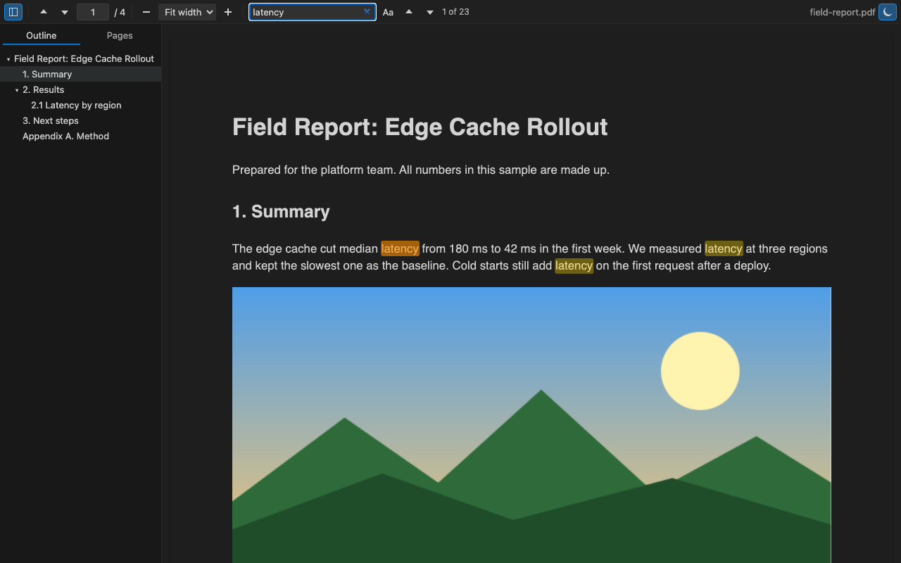
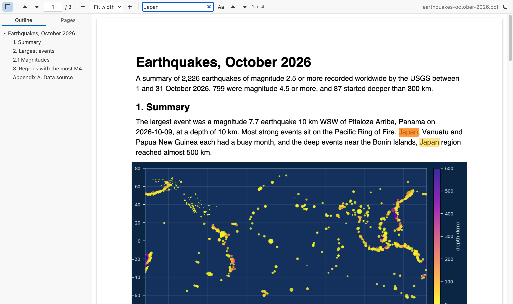
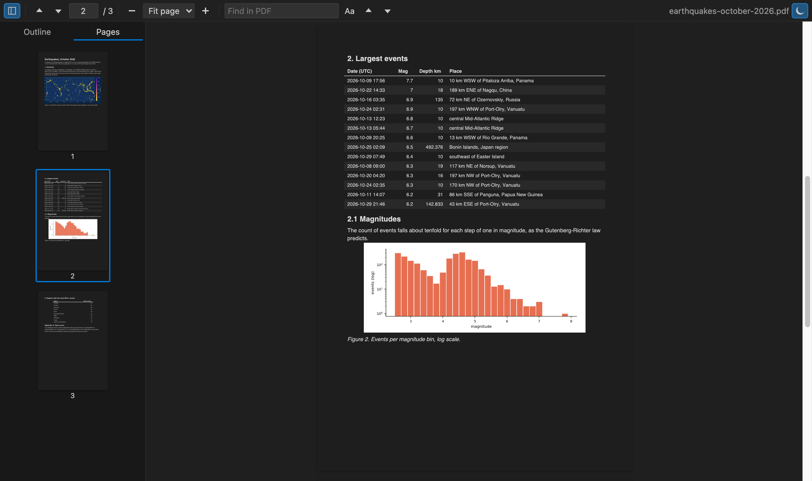
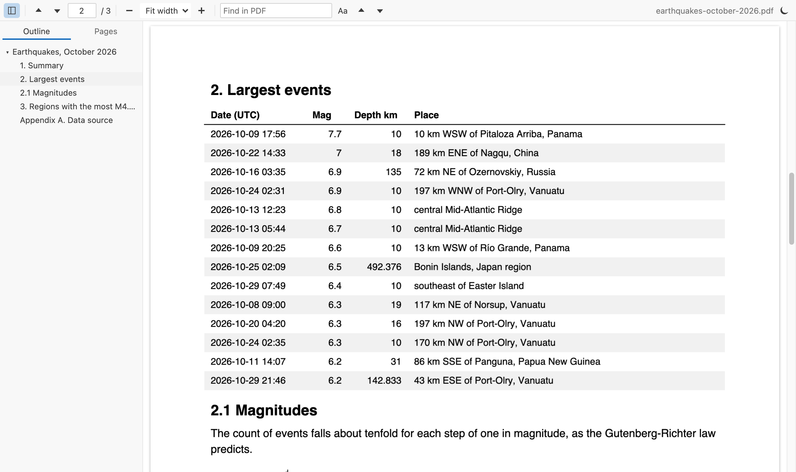

# PDF Viewer & PDF Reader

<a href="https://marketplace.visualstudio.com/items?itemName=zovo.pdf-viewer-dark"></a>
<a href="https://marketplace.visualstudio.com/items?itemName=zovo.pdf-viewer-dark"></a>

A PDF viewer and PDF reader for VS Code. Read specs and papers next to your code on dark or sepia pages that keep photos in their real colors, and highlight the parts you want to find again.



- Highlights: select text and pick one of 4 colors, or press `H`. The Highlights tab lists them, a click jumps back, and "Copy as Markdown" gives you a list with a link to each page for your notes. The PDF file is not changed.
- Dark and sepia pages: dark pages for night, warm sepia pages for long reading. Text, lines and backgrounds change color. Photos keep theirs.
- Find, outline and pages: Find in PDF highlights every match, and the sidebar has the outline and page thumbnails. Each PDF reopens where you left it. It runs offline, with no telemetry.

## Quick start

1. Install the extension.
2. Click any `.pdf` file in the Explorer. Press `Ctrl+F` (`Cmd+F` on macOS) to search, and click the moon button to switch dark pages on or off.



*Recorded in the same window. The white arrow is drawn in to show where each click lands.*

Run "Get Started with PDF Reader" from the Welcome page for a short tour.

## Highlights you can take to your notes

Select text on a page. A small bar with 4 colors appears under the selection. Click a color, or press `H` for yellow.



The sidebar's Highlights tab lists every highlight of the file with its page. Click one to jump to it, or click × to remove it. Highlights are saved in VS Code on this computer, for each file, and come back when you open the PDF again. They are not written into the PDF.

"Copy as Markdown" (or "PDF: Copy Highlights as Markdown" in the Command Palette) copies a list like this:

```markdown
## Highlights in earthquakes-october-2026.pdf

- "The largest event was a magnitude 7.7 earthquake 10 km WSW of Pitaloza Arriba, Panama on" ([page 1](/docs/earthquakes-october-2026.pdf#page=1))
```

Paste it into a `.md` file. In the Markdown preview each link opens the PDF at that page.



## Sepia pages

The paper button next to the moon switches the open PDF to warm sepia pages, which are softer on the eyes than white. Photos and images keep their colors, as in dark mode. Set `pdfViewer.lightPages` to `sepia` to use it for every PDF.



## Dark mode that leaves images alone

Most dark PDF modes invert the whole page, so a photo of a blue sky turns orange. This viewer inverts the page, then paints the original pixels of each raster image back on top.



By default the pages follow your VS Code theme. Dark and high contrast dark themes get dark pages, light themes get the page as printed. The moon button in the toolbar, or "PDF: Toggle Dark Pages" in the Command Palette, switches it for the open file. Set `pdfViewer.darkMode` to `on` or `off` to stop following the theme.

Charts drawn as vector lines are inverted like text, because to the PDF they are lines, not pictures. A chart embedded as an image keeps its colors.

## Search, outline and pages

Type in "Find in PDF". Matches light up on every page as the search runs, and the counter shows "3 of 23". Press `Enter` for the next match and `Shift+Enter` for the previous one. "Aa" turns on match case.

The sidebar has two tabs. Outline shows the PDF's bookmarks as a tree, and a click jumps to the exact spot. Pages shows a thumbnail of each page, with the current one marked.

The sidebar stays closed until you open it, also for LaTeX PDFs with bookmarks. To change that, set `pdfViewer.sidebar` to `open` (open it for every PDF) or `remember` (keep it the way you left it in the last PDF).


## Zoom and position

Pick Fit width, Fit page, or 50% to 400% from the toolbar. `Ctrl` plus the mouse wheel, `Ctrl+=` and `Ctrl+-` also zoom (`Cmd` on macOS). They zoom the PDF, not the VS Code window.

Each PDF reopens at the page and zoom where you left it. When the file changes on disk, for example after a LaTeX build, the viewer reloads it and stays on the same page.

## Go to a page, and link to it from your notes

Press `Ctrl+G` in a PDF, type a page number and press `Enter`.

Links in Markdown can open a PDF at a page, the same way they work in a browser. Write `[paper](docs/paper.pdf#page=12)` in a `.md` file, then click it in the Markdown preview. `#nameddest=results` opens a named destination of the PDF, and `&zoom=150` sets the zoom.

You don't have to type the links. "PDF: Copy Link to This Page" copies a link to the page you are reading, ready to paste into your notes.


## Keys

| Key | Action |
| --- | --- |
| `Ctrl+F` / `Cmd+F` | Find in PDF |
| `Enter`, `Shift+Enter`, `F3` | Next or previous match |
| `Esc` in the search box | Clear the search |
| `←` `→` | Previous or next page |
| `Home`, `End` | First or last page |
| `Ctrl+=`, `Ctrl+-` | Zoom in, zoom out |
| `Ctrl+G` | Go to page |
| `H` | Highlight the selected text in yellow |

The viewer leaves other VS Code keys alone. `Ctrl+P` opens Quick Open and `Ctrl+Shift+P` opens the Command Palette, as in any other editor.

## Settings

| Setting | Default | What it does |
| --- | --- | --- |
| `pdfViewer.darkMode` | `auto` | `auto` follows the theme, `on` always dark, `off` never dark |
| `pdfViewer.keepImagesInDarkMode` | `true` | Keep raster images in their colors on dark and sepia pages |
| `pdfViewer.lightPages` | `white` | `sepia` shows light pages in warm paper colors |
| `pdfViewer.defaultZoom` | `page-width` | Zoom for a PDF you open for the first time |
| `pdfViewer.rememberLastPage` | `true` | Reopen each PDF at the last page and zoom (up to 500 files) |
| `pdfViewer.sidebar` | `closed` | `closed` keeps the sidebar closed, `open` opens it for every PDF, `remember` keeps your last choice |
| `pdfViewer.maxFileSizeMB` | `200` | Ask before opening larger PDFs |
| `pdfViewer.askForRating` | `true` | Ask one time for a Marketplace rating, after 5 files and 2 days. Turn it off with `false` |

## More screenshots

| Dark pages, search and outline | Light theme |
|---|---|
| <a href="https://raw.githubusercontent.com/theluckystrike/pdf-viewer-vscode/main/images/screenshot-dark.png"></a> | <a href="https://raw.githubusercontent.com/theluckystrike/pdf-viewer-vscode/main/images/screenshot-light.png"></a> |

| Page thumbnails, dark | Outline jump, light |
|---|---|
| <a href="https://raw.githubusercontent.com/theluckystrike/pdf-viewer-vscode/main/images/screenshot-pages.png"></a> | <a href="https://raw.githubusercontent.com/theluckystrike/pdf-viewer-vscode/main/images/outline-light.png"></a> |

*Real output, light and dark. The extension's own webview code and its bundled pdf.js render [`test/fixtures/earthquakes-october-2026.pdf`](https://github.com/theluckystrike/pdf-viewer-vscode/blob/main/test/fixtures/earthquakes-october-2026.pdf), a 3 page report built from the real USGS earthquake catalog for October 2026. [`scripts/readme-shots`](https://github.com/theluckystrike/pdf-viewer-vscode/tree/main/scripts/readme-shots) has the scripts that build the PDF and capture the shots in headless Chrome.*

## Privacy and security

The extension reads the PDF with the VS Code file system API and hands the bytes to the viewer. It doesn't upload anything, and it has no telemetry. The viewer runs under a strict Content-Security-Policy that allows only the extension's own scripts. Titles, text and links from the PDF are always inserted as plain text. PDF JavaScript and forms scripting are not run.

A link inside a PDF opens in your browser only when you click it, and only for `http`, `https` and `mailto` links.

## Known limits

- Highlights live in VS Code on this computer, not in the PDF file, so other PDF apps don't show them and they don't sync to other machines.
- It doesn't fill forms, edit the PDF or print.
- Big files load fully into memory. Above 200 MB it asks first, and you can change the limit.
- Pages render on demand, so a 1,000 page PDF opens at page 1 at once, but search reads every page and takes longer on very long files.
- A `#page=` link opens the page from the Markdown preview. A `Ctrl`+click on the same link in the text editor opens the PDF at the page you read last, because VS Code drops the part after `#` there.
- If another PDF extension is installed, VS Code may ask which one to use. Right-click a PDF and pick "Open With..." to switch.

## Credits

PDF rendering by [pdf.js](https://github.com/mozilla/pdf.js) from Mozilla (Apache-2.0), bundled in `media/pdfjs`. The extension itself is MIT licensed.

[Rate this extension](https://marketplace.visualstudio.com/items?itemName=zovo.pdf-viewer-dark&ssr=false#review-details) on the Marketplace if it helps you read PDFs. A rating helps other people find it.

## Support Zovo

Zovo extensions are free, with no ads and no tracking. They are made by [theluckystrike](https://github.com/theluckystrike) on GitHub. If this one saves you time, you can support the work:

- [Sponsor on GitHub](https://github.com/sponsors/theluckystrike)
- [Follow theluckystrike on GitHub](https://github.com/theluckystrike)

## More tools by Zovo

- [DOCX Viewer, Word Viewer & DOCX Preview (Dark Mode)](https://marketplace.visualstudio.com/items?itemName=zovo.docx-viewer-vscode) previews Word and ODT files with dark mode, an outline and search.
- [PPTX Viewer & PowerPoint Viewer, PPT Slide Viewer](https://marketplace.visualstudio.com/items?itemName=zovo.pptx-slide-viewer) shows PowerPoint slides, thumbnails and speaker notes.
- [EPUB Viewer, EPUB Reader & Ebook Reader](https://marketplace.visualstudio.com/items?itemName=zovo.zovo-epub-reader) reads EPUB books with a table of contents, search and light, sepia or dark themes.
- [XLSX Viewer, Excel Viewer, CSV Viewer & Parquet Viewer](https://marketplace.visualstudio.com/items?itemName=zovo.table-viewer-vscode) opens CSV, TSV, Excel and Parquet files as a sortable, filterable table.
- [EML Viewer, Email Headers & MBOX Viewer](https://marketplace.visualstudio.com/items?itemName=zovo.eml-viewer) reads EML, EMLX and MBOX email files with remote images blocked.

See [all Zovo extensions on the Marketplace](https://marketplace.visualstudio.com/publishers/zovo).

## More from zovo

- [All free zovo VS Code extensions](https://marketplace.visualstudio.com/publishers/zovo) — file viewers, database clients, formatters. Offline, no telemetry, no sign-up.
- [Full MCP server catalogue](https://theluckystrike.github.io/mcp/) — local-first MCP servers for back-office work: invoices, VAT, PDFs, spreadsheets, payroll.
- [Hosted no-install MCP endpoints](https://mcp.zovo.one) — paste a URL in Claude / Cursor, nothing to install.
