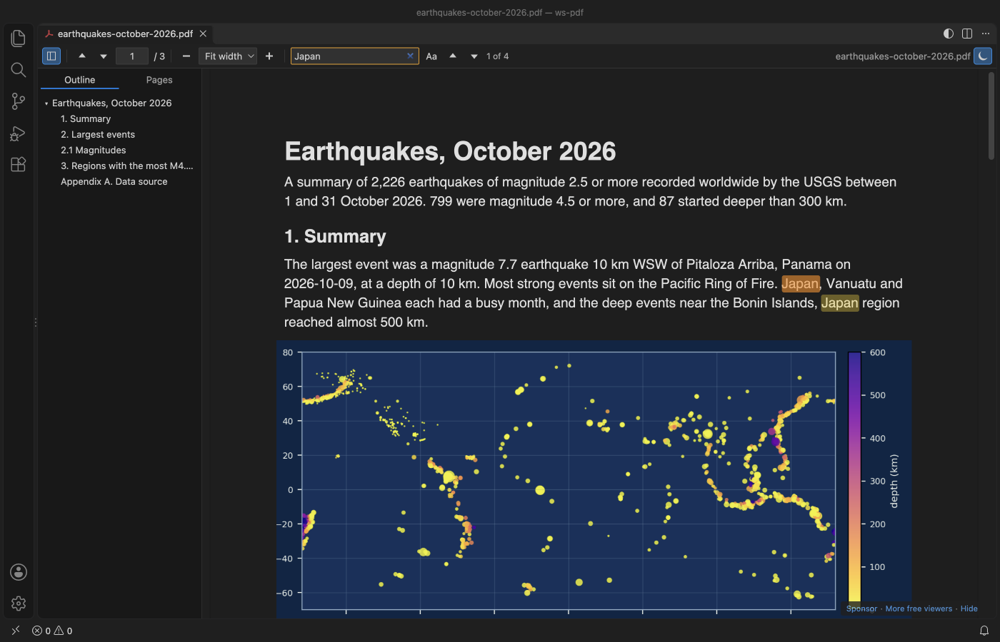

# PDF Viewer & PDF Reader with Dark Mode

For developers who read specs and papers next to their code, this PDF viewer and PDF reader shows PDFs in VS Code with dark pages that keep photos and charts in their real colors.

*A real VS Code 1.142 window running this extension on [`test/fixtures/earthquakes-october-2026.pdf`](https://github.com/theluckystrike/pdf-viewer-vscode/blob/main/test/fixtures/earthquakes-october-2026.pdf), a 3 page report generated from the USGS earthquake catalog for October 2026.*

- Dark pages that are easy on the eyes at night. Text, lines and backgrounds go dark. Photos keep their colors.
- Find in PDF highlights every match and jumps between them with Enter. The outline and page thumbnails sit in one sidebar.
- It runs offline. pdf.js is bundled inside the extension, and it makes no network calls and sends no telemetry.

## Quick start

1. Install the extension.
2. Click any `.pdf` file in the Explorer. Press `Ctrl+F` (`Cmd+F` on macOS) to search, and click the moon button to switch dark pages on or off.

*Recorded in the same window. The white arrow is drawn in to show where each click lands.*

Run "Get Started with PDF Reader" from the Welcome page for a short tour.

## Dark mode that leaves images alone

Most dark PDF modes invert the whole page, so a photo of a blue sky turns orange. PDF Reader inverts the page, then paints the original pixels of each raster image back on top.

By default the pages follow your VS Code theme. Dark and high contrast dark themes get dark pages, light themes get the page as printed. The moon button in the toolbar, or "PDF: Toggle Dark Pages" in the Command Palette, switches it for the open file. Set `pdfViewer.darkMode` to `on` or `off` to stop following the theme.

Charts drawn as vector lines are inverted like text, because to the PDF they are lines, not pictures. A chart embedded as an image keeps its colors.

## Search, outline and pages

Type in "Find in PDF". Matches light up on every page as the search runs, and the counter shows "3 of 23". Press `Enter` for the next match and `Shift+Enter` for the previous one. "Aa" turns on match case.

The sidebar has two tabs. Outline shows the PDF's bookmarks as a tree, and a click jumps to the exact spot. Pages shows a thumbnail of each page, with the current one marked.

The sidebar stays closed until you open it, also for LaTeX PDFs with bookmarks. To change that, set `pdfViewer.sidebar` to `open` (open it for every PDF) or `remember` (keep it the way you left it in the last PDF).

## Zoom and position

Pick Fit width, Fit page, or 50% to 400% from the toolbar. `Ctrl` plus the mouse wheel, `Ctrl+=` and `Ctrl+-` also zoom (`Cmd` on macOS). They zoom the PDF, not the VS Code window.

Each PDF reopens at the page and zoom where you left it. When the file changes on disk, for example after a LaTeX build, the viewer reloads it and stays on the same page.

## Go to a page, and link to it from your notes

Press `Ctrl+G` in a PDF, type a page number and press `Enter`.

Links in Markdown can open a PDF at a page, the same way they work in a browser. Write `[paper](docs/paper.pdf#page=12)` in a `.md` file, then click it in the Markdown preview. `#nameddest=results` opens a named destination of the PDF, and `&zoom=150` sets the zoom.

You don't have to type the links. "PDF: Copy Link to This Page" copies a link to the page you are reading, ready to paste into your notes.

## Keys

| Key | Action |
| --- | --- |
| `Ctrl+F` / `Cmd+F` | Find in PDF |
| `Enter`, `Shift+Enter`, `F3` | Next or previous match |
| `Esc` in the search box | Clear the search |
| `←` `→` | Previous or next page |
| `Home`, `End` | First or last page |
| `Ctrl+=`, `Ctrl+-` | Zoom in, zoom out |
| `Ctrl+G` | Go to page |

The viewer leaves other VS Code keys alone. `Ctrl+P` opens Quick Open and `Ctrl+Shift+P` opens the Command Palette, as in any other editor.

## Settings

| Setting | Default | What it does |
| --- | --- | --- |
| `pdfViewer.darkMode` | `auto` | `auto` follows the theme, `on` always dark, `off` never dark |
| `pdfViewer.keepImagesInDarkMode` | `true` | Keep raster images in their colors in dark mode |
| `pdfViewer.defaultZoom` | `page-width` | Zoom for a PDF you open for the first time |
| `pdfViewer.rememberLastPage` | `true` | Reopen each PDF at the last page and zoom (up to 500 files) |
| `pdfViewer.sidebar` | `closed` | `closed` keeps the sidebar closed, `open` opens it for every PDF, `remember` keeps your last choice |
| `pdfViewer.maxFileSizeMB` | `200` | Ask before opening larger PDFs |
| `pdfViewer.askForRating` | `true` | Ask one time for a Marketplace rating, after 5 files and 2 days. Turn it off with `false` |

## More screenshots

| Dark pages, search and outline | Light theme |
|---|---|
|  |  |

| Page thumbnails, dark | Outline jump, light |
|---|---|
|  |  |

*Real output, light and dark. The extension's own webview code and its bundled pdf.js render [`test/fixtures/earthquakes-october-2026.pdf`](https://github.com/theluckystrike/pdf-viewer-vscode/blob/main/test/fixtures/earthquakes-october-2026.pdf), a 3 page report built from the real USGS earthquake catalog for October 2026. [`scripts/readme-shots`](https://github.com/theluckystrike/pdf-viewer-vscode/tree/main/scripts/readme-shots) has the scripts that build the PDF and capture the shots in headless Chrome.*

## Privacy and security

The extension reads the PDF with the VS Code file system API and hands the bytes to the viewer. It doesn't upload anything, and it has no telemetry. The viewer runs under a strict Content-Security-Policy that allows only the extension's own scripts. Titles, text and links from the PDF are always inserted as plain text. PDF JavaScript and forms scripting are not run.

A link inside a PDF opens in your browser only when you click it, and only for `http`, `https` and `mailto` links.

## Known limits

- It is a viewer. It doesn't fill forms, add annotations or print.
- Big files load fully into memory. Above 200 MB it asks first, and you can change the limit.
- Pages render on demand, so a 1,000 page PDF opens at page 1 at once, but search reads every page and takes longer on very long files.
- A `#page=` link opens the page from the Markdown preview. A `Ctrl`+click on the same link in the text editor opens the PDF at the page you read last, because VS Code drops the part after `#` there.
- If another PDF extension is installed, VS Code may ask which one to use. Right-click a PDF and pick "Open With..." to switch.

## Credits

PDF rendering by [pdf.js](https://github.com/mozilla/pdf.js) from Mozilla (Apache-2.0), bundled in `media/pdfjs`. The extension itself is MIT licensed.

[Rate this extension](https://marketplace.visualstudio.com/items?itemName=zovo.pdf-viewer-dark&ssr=false#review-details) on the Marketplace if it helps you read PDFs. A rating helps other people find it.

## Support

Zovo extensions have no ads and no tracking, and sponsors pay for the time that goes into fixes and new viewers. You can sponsor the work on [GitHub Sponsors](https://github.com/sponsors/theluckystrike).

## More viewers by Zovo

- [DOCX Viewer & Word Viewer with Dark Mode](https://marketplace.visualstudio.com/items?itemName=zovo.docx-viewer-vscode) previews Word and ODT files with dark mode, an outline and search.
- [CSV Viewer, Excel Viewer (XLSX) & Parquet Viewer](https://marketplace.visualstudio.com/items?itemName=zovo.table-viewer-vscode) opens CSV, TSV, Excel and Parquet files as a sortable, filterable table.
- [PPTX Viewer & PowerPoint Viewer](https://marketplace.visualstudio.com/items?itemName=zovo.pptx-slide-viewer) shows PowerPoint slides, thumbnails and speaker notes.
- [MP4 Video Player & Video Preview with Sound](https://marketplace.visualstudio.com/items?itemName=zovo.video-preview-with-sound) plays MP4, MOV, MKV and WebM files with their sound.
- [Large JSON Viewer & JSON Tree](https://marketplace.visualstudio.com/items?itemName=zovo.zovo-json-tree-viewer) shows large JSON files as a searchable tree, copies JSONPath and turns arrays of objects into a table.
- [JSONL Viewer & NDJSON Viewer (JSONL Table)](https://marketplace.visualstudio.com/items?itemName=zovo.zovo-jsonl-viewer) opens JSONL and NDJSON files as a table, as records or as a chat view.
- [SQLite Viewer & DB Viewer (Read-Only)](https://marketplace.visualstudio.com/items?itemName=zovo.sqlite-table-viewer) browses SQLite tables read-only and runs SELECT queries.
- [HDF5 & NetCDF Explorer (H5 Viewer)](https://marketplace.visualstudio.com/items?itemName=zovo.hdf5-netcdf-explorer) browses groups, attributes and values in HDF5 and NetCDF files and plots slices.
- [GGUF, Safetensors & NPY Viewer (NumPy Viewer)](https://marketplace.visualstudio.com/items?itemName=zovo.tensor-viewer) shows NPY, NPZ, Safetensors and GGUF tensors with stats and heatmaps.
- [DXF Viewer & CAD Viewer for 2D Drawings](https://marketplace.visualstudio.com/items?itemName=zovo.dxf-viewer) opens ASCII and binary DXF drawings with layers, measuring and PNG or SVG export.
- [AGENTS.md & CLAUDE.md Linter (Context Drift)](https://marketplace.visualstudio.com/items?itemName=zovo.context-drift) finds stale commands, paths and versions in AGENTS.md and CLAUDE.md files.
- [Agent Skills & Claude Skills (Skill Shelf)](https://marketplace.visualstudio.com/items?itemName=zovo.skill-shelf) lists, checks and toggles the Agent Skills that Claude Code, Codex and Cursor load.
- [Claude Code History & Codex History Viewer](https://marketplace.visualstudio.com/items?itemName=zovo.agent-session-viewer) browses and searches your local Claude Code and Codex sessions.
- [Claude Code Usage & Codex Usage Cost Meter](https://marketplace.visualstudio.com/items?itemName=zovo.ai-usage-meter) shows Claude Code and Codex tokens and estimated cost from your local session files.

Coming soon to the Marketplace, with the code on GitHub now.

- [EPUB Reader & EPUB Viewer](https://github.com/theluckystrike/epub-reader-vscode) reads EPUB books with a table of contents, search and light, sepia or dark themes.
- [EML Viewer & MBOX Email Viewer](https://github.com/theluckystrike/eml-viewer-vscode) reads EML, EMLX and MBOX email files with remote images blocked.
- [Audio Preview & Loudness Meter](https://github.com/theluckystrike/audio-preview-vscode) plays audio files with a waveform, a spectrogram and LUFS loudness.
- [Graphviz Preview & DOT Viewer](https://github.com/theluckystrike/graphviz-preview-vscode) shows a live preview of DOT files and exports SVG or PNG.
- [TIFF Viewer (16-bit, Float, GeoTIFF)](https://github.com/theluckystrike/tiff-viewer-vscode) opens 16-bit, float, multi-page and GeoTIFF images.
- [Avro Viewer, Arrow Viewer & Feather Viewer](https://github.com/theluckystrike/arrow-avro-viewer-vscode) opens Avro, Arrow and Feather files as a paged table.
- [3D Model Viewer (GLB, glTF, STL, OBJ, PLY)](https://github.com/theluckystrike/model-viewer-vscode) views GLB, glTF, STL, OBJ, PLY and 3MF models.
- [PKL Viewer & Pickle Viewer](https://github.com/theluckystrike/pickle-viewer-vscode) opens Python pickle files without Python and never runs their code.
- [DICOM Viewer & NIfTI Viewer for CT and MRI](https://github.com/theluckystrike/dicom-nifti-viewer-vscode) opens CT and MRI scans, DICOM folders and NIfTI volumes with window presets and three views.
- [ZIP Viewer & Archive Explorer (JAR, TAR, GZ)](https://github.com/theluckystrike/archive-explorer-vscode) browses ZIP, JAR, VSIX, TAR and GZ files, opens entries in tabs and extracts them safely.
- [GCode Viewer & 3D Print Preview](https://github.com/theluckystrike/gcode-viewer-vscode) shows GCode toolpaths in 3D layer by layer, with print time and filament use.
- [HAR Viewer & HTTP Archive Viewer](https://github.com/theluckystrike/har-viewer-vscode) opens HAR files from browser DevTools with a timing waterfall, filters and a redacted copy for sharing.
- [Font Viewer & Font Preview (TTF, OTF, WOFF)](https://github.com/theluckystrike/font-viewer-vscode) opens TTF, OTF, WOFF, WOFF2 and TTC fonts with a glyph grid, a type tester with variable axes and the license fields.
- [File Viewers Pack](https://github.com/theluckystrike/zovo-file-viewers) installs the PDF, table, Word, PowerPoint, HDF5 and tensor viewers in one step.
